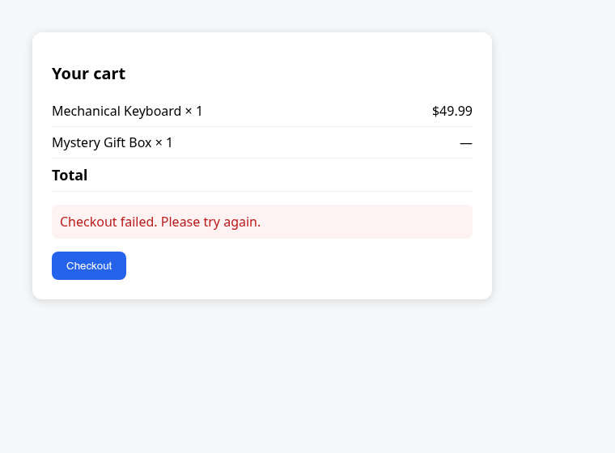

# Visual Bug-to-Code Investigator

Go from a visual bug report to an evidence-backed, test-verified explanation
of its likely source-code cause.

Upload a screenshot of a broken UI, describe the bug, optionally paste browser
console/network logs, and point the tool at the local repository. It finds the
relevant code across files, ranks hypotheses with supporting *and*
contradicting evidence, verifies the leading hypothesis with real tests, and
proposes a reviewable fix plus a regression test.

Every source claim links to an actual file and line range that is revalidated
before display. When evidence is insufficient, the tool abstains
(`inconclusive`) instead of guessing. A screenshot alone is treated as
Level-1 evidence: it can show *what* is visibly wrong, never *which line*
caused it — that link must be earned through code and tests.



*The demo app's broken cart (real screenshot, headless Chromium):
total blank, checkout failed. Root cause is three files away.*

## Quick start

No dependencies beyond Python 3.11+ (stdlib only; `pytest` runs target repos'
tests and this project's suite).

```bash
git clone https://github.com/HPHYSVN/ai-repository-investigator.git
cd ai-repository-investigator
python3 run.py            # http://127.0.0.1:8765 (localhost only)
```

The UI is pre-filled with the demo scenario against `demo_webapp/`. Click
**Investigate**, then optionally enable test execution (explicit confirmation
dialog) to watch the hypothesis become `verified`.

## The demo bug (try it in 2 minutes)

`demo_webapp/` is a small shop: `cart.js` renders the total from
`POST /api/checkout` (`cart_api.py` → `cart.py` → `pricing.py`). Adding a
gift-box SKU makes the total blank and checkout fail. The failure surfaces in
`pricing.format_price`, but the cause is `cart.cart_total` silently returning
`None` for an unknown SKU. Full walkthrough: `docs/demo-script.md`.

## How it works

Deterministic tools first, Meta models only where they add judgement:

| Stage | Implementation | Meta model? |
|---|---|---|
| Screenshot validation | magic-byte/MIME/size checks (≤5 MB) in `app/visual.py` | no |
| Visual symptom analysis | structured JSON (observable / inferred / cannot-determine) | **yes — Muse Spark 1.3 image understanding** |
| Console/network log parsing | regex extraction, secret/header redaction (`app/logs.py`) | no |
| Repo indexing | `.gitignore`-aware walk, Python AST, JS/TS lexical symbols, BM25 | no |
| Root-cause detectors | None-return, `.get()` w/o default, boundary, config-key, unconverted producer output, unresolved imports | no |
| Dependency path | BFS over extracted import/call graph (reachability, not a runtime trace) | no |
| Hypotheses | ranked, supporting + contradicting evidence, labelled confidence | deterministic; model may summarise |
| Verification | allow-listed pytest, explicit confirmation, real exit codes | no |
| Report synthesis | evidence-bound summary; model citations re-checked, unverified ones stripped | **yes (optional)** |
| Proposed fix | unified diff from the confirmed pattern + suggested regression test; never auto-applied | no |

Outcomes: `verified` (an executed test confirmed the cause) · `likely`
(static/graph evidence, no confirming test) · `inconclusive` (abstention) ·
`not_reproducible` (selected tests pass, nothing confirmed). Evidence levels
L1 screenshot → L2 description → L3 logs → L4 source link → L5 test-verified
are shown per investigation.

## Meta Model API

Verified 2026-10-31 against official docs (dev.meta.ai/docs): base URL
`https://api.meta.ai/v1`, Responses API, Bearer `MODEL_API_KEY`;
`muse-spark-1.3` supports image input via `input_image` base64 data URLs.

```bash
export MODEL_API_KEY="..."                # your Model API dashboard key
export MODEL_API_MODEL="muse-spark-1.3"   # optional (default) or muse-wonder-1.0
python3 run.py
```

Without a key the tool runs in a fully deterministic degraded mode
(screenshot analysis reports metadata only and says so — it does not invent
image content). Caps: `INVESTIGATOR_MAX_MODEL_CALLS` (2),
`INVESTIGATOR_BUDGET_USD` (1.00); 429 backoff; usage/cost ledger in the UI.
Secrets are redacted from logs and evidence before any model call.

> **Live Meta inference status: VERIFIED on 2026-10-31.** With a real
> `MODEL_API_KEY` (loaded from a local, gitignored `.env`): a text request
> returned successfully, and a full demo investigation ran both live calls —
> `visual-analysis` on `demo_webapp/screenshot.png` (731 in / ~1,600 out
> tokens; the model correctly observed the blank Total, the "—" gift-box
> price, and the checkout-failure banner, and listed what it could not
> determine) and `synthesis` (~$0.019 total for the investigation) —
> ending at outcome `verified` with evidence levels L1–L5 all satisfied.
> Stub-based tests (`tests/test_model_adapter_http.py`, `tests/test_visual.py`)
> still cover the same paths without a key or spend.

## Benchmarks (measured, synthetic fixtures, $0 model spend)

```bash
python3 -m pytest tests/ -q                  # 32 tests
python3 benchmarks/run_visual_benchmarks.py  # 10-case visual benchmark
python3 benchmarks/run_benchmarks.py         # original 5-case ARI benchmark
python3 benchmarks/run_adversarial.py        # adversarial cases (separate)
```

Visual benchmark (10 controlled cases: null-across-files, JS rendering,
API field mismatch, discarded state update, data transform, broken import,
boundary, config mismatch, misleading stack trace, ambiguous→abstain):
**root-cause accuracy 8/9 scored cases (0.889)**, abstention 1/1, citation
validity 1.0 (existence/range/hash — not semantic proof), 5/9 cases reached
`verified`. The missed case (cents→dollars transform) is reported as-is in
`benchmarks/visual/results.json`. These are small synthetic Python/JS
fixtures — they do not establish real-world generalisation. Expected answers
live outside the indexed fixtures; fixtures run from temp copies.

## Security (read before use on untrusted repos)

- Localhost-only, no auth: a local developer tool, not a hosted service.
- **Test execution runs repository code with your privileges, unsandboxed.**
  Off by default; requires explicit per-run confirmation;
  `INVESTIGATOR_DISABLE_TEST_EXECUTION=1` disables it;
  `INVESTIGATOR_ALLOWED_ROOTS` can confine repo paths. Subprocess env strips
  API keys/tokens; 60 s timeout. Only confirm runs in repos you trust.
- Screenshots/logs/repo content are untrusted: UI escaping (no inline
  handlers), log header/secret redaction, prompt-injection treated as data.
- Repo paths are validated; uploads are size/MIME capped. Full notes in the
  previous README sections preserved in git history and `docs/`.

## Limitations

- Symbol/call extraction is full-AST for Python, lexical-only for JS/TS;
  other languages get BM25 search without detectors or graph edges.
- Detectors are heuristics — expect false leads and `inconclusive` on large
  real repos. Dependency paths are graph reachability, not runtime traces.
- No browser extension, DOM-to-source mapping, video, or auto-applied fixes.
- Live Meta inference was verified on 2026-10-31 (see above); behaviour
  without a key is the deterministic degraded mode.

## Layout & docs

`app/` server, orchestrator, index, visual/log analysis, Meta adapter, UI ·
`demo_webapp/` demo shop + screenshot · `sample_repo/` original demo ·
`benchmarks/` suites + measured results · `tests/` 32 tests ·
`docs/architecture.md` · `docs/demo-script.md` · `docs/progress.md` ·
`docs/decisions.md` · `docs/review-findings.md` (independent review + resolutions).
